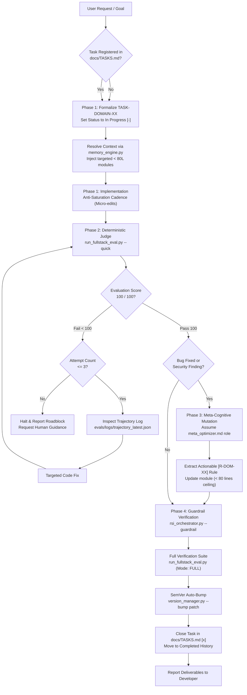

# Agentic RSI Protocol

[](https://opensource.org/licenses/MIT)
[](https://www.python.org/)
[]()
[]()
[]()

The **Recursive Self-Improvement (RSI) Protocol** is a language-agnostic engineering framework designed specifically for modern **Agentic Coding Environments** (such as Cursor, Windsurf, Google Antigravity, Claude Code, GitHub Copilot Workspace, and Cline / Roo Code).

It establishes an inviolable contract between human developers and autonomous coding agents: eliminating context saturation, preventing unverified mutations, enforcing deterministic evaluation, and enabling agents to distill debugging lessons into durable procedural memory.

---

## Table of Contents

- [The Challenge with Modern Agentic Coding Environments](#the-challenge-with-modern-agentic-coding-environments)
- [The RSI Architectural Solution](#the-rsi-architectural-solution)
- [How It Works: The 4-Phase Execution Cycle](#how-it-works-the-4-phase-execution-cycle)
- [Operational Architecture Diagram](#operational-architecture-diagram)
- [Key Guarantees and Capabilities](#key-guarantees-and-capabilities)
  - [1. Inviolable Single Source of Truth](#1-inviolable-single-source-of-truth-ssot)
  - [2. Memory Duality and Anti-Bloat Guardrails](#2-memory-duality-and-anti-bloat-guardrails)
  - [3. Dynamic Contextual Injection](#3-dynamic-contextual-injection)
  - [4. Adaptive Deterministic Judge](#4-adaptive-deterministic-judge)
  - [5. Meta-Cognitive Mutation Loop](#5-meta-cognitive-mutation-loop)
  - [6. Zero-Leak Security Audit](#6-zero-leak-security-audit)
  - [7. Universal ASCII Terminal Compatibility](#7-universal-ascii-terminal-compatibility)
- [Quick Start Guide](#quick-start-guide)
  - [Using as a GitHub Template](#using-as-a-github-template)
  - [Integrating into an Existing Codebase](#integrating-into-an-existing-codebase)
- [Agent Slash Commands and Workflows](#agent-slash-commands-and-workflows)
  - [`/rsi-feature` - End-to-End Feature Development](#rsi-feature---end-to-end-feature-development)
  - [`/reset-rsi` - Starting a Fresh Project](#reset-rsi---starting-a-fresh-project)
- [Repository Layout](#repository-layout)
- [CLI Tooling Reference](#cli-tooling-reference)
- [Inviolable Rules for AI Agents](#inviolable-rules-for-ai-agents)
- [Contributing](#contributing)
- [License](#license)

---

## The Challenge with Modern Agentic Coding Environments

Autonomous coding agents (Cursor Agent, Windsurf Cascade, Google Antigravity, Claude Code, Cline) are capable of inspecting entire workspaces, generating multi-file edits, and running terminal commands. However, on non-trivial production projects, they consistently encounter critical failure modes:

1. **Context Window Exhaustion:** Developers often provide massive system prompts, 500-line `.cursorrules` files, or long markdown manuals. As conversation history grows, the agent's effective attention degrades, leading to hallucinated dependencies, regression bugs, and discarded architectural rules.
2. **Session Amnesia:** When an agent spends several turns debugging a subtle issue (e.g., race conditions, ORM connection exhaustion, missing authentication middleware), the resolution vanishes when the chat session ends. In subsequent sessions, the agent makes the exact same mistake.
3. **Unchecked Code Mutations:** Without a strict pre-commit test gate, agents generate broken imports, subtle type errors, or non-compiling schema changes that accumulate silently across tasks.
4. **Platform Encoding Failures:** Evaluation and automation scripts using multi-byte emojis or decorative Unicode symbols frequently crash with `UnicodeEncodeError: 'charmap'` when run in standard Windows terminals (CP1252), Linux minimal containers, or CI runners.

---

## The RSI Architectural Solution

The **Agentic RSI Protocol** introduces a deterministic, self-contained closed feedback loop for coding agents:

- **Strict Task Governance:** The agent cannot write or edit code without an explicit task registered in `docs/TASKS.md`.
- **Dynamic Context Injection:** Rather than loading all engineering rules into every prompt, rules are split into modular sub-playbooks (`< 80 lines` each) in `.agents/rules/modules/`. The engine inspects target files and injects only relevant rules.
- **Deterministic Judge:** A lightweight evaluation harness (`evals/run_fullstack_eval.py`) validates typecheck, linters, schemas, security leaks, and memory compactness.
- **Reflexive Auto-Correction:** If the evaluation score is below 100/100, the agent has up to 3 automated retry attempts, reading compact failure logs.
- **Meta-Cognitive Learning:** After resolving an unexpected defect or security finding, the agent distills the fix into an actionable, permanent rule in the appropriate module.

---

## Operational Architecture Diagram



---

## Key Guarantees and Capabilities

### 1. Inviolable Single Source of Truth (SSOT)
- Tracked strictly in `docs/TASKS.md`.
- Tasks must specify an identifier (`TASK-DOMAIN-XX`), priority, target files, and checkable acceptance criteria (`[ ]`).
- Strict ceiling: `docs/TASKS.md` must never exceed **250 lines**. Completed sprints are archived into `docs/archive/tasks/`.

### 2. Memory Duality and Anti-Bloat Guardrails
- **Episodic Memory (IDE Artifacts):** Volatile scratchpads, task checklists, and architectural outlines remain in IDE Brain artifacts rather than chat messages, saving token context.
- **Procedural Memory (Modular Rules):** Permanent engineering rules live in `.agents/rules/modules/`. Each module is strictly limited to **< 80 lines**. If a file nears this limit, overlapping rules must be synthesized.

### 3. Dynamic Contextual Injection
Instead of overwhelming the LLM with generic manuals, `evals/memory_engine.py` maps file paths to domain rules:

```bash
# Example: Injecting rules relevant to an API route and user session
python evals/memory_engine.py --inject src/app/api/auth/route.ts
```

Output:
```
[RSI Dynamic Memory Injection]
--- [Module: api_backend.md] ---
- [R-API-01] Consistently return predictable structures matching { success: true, data } | { success: false, error }.
- [R-API-02] Protect sensitive endpoints and submission forms with rate-limiting.
...
--- [Module: security_auth.md] ---
- [R-SEC-01] Strictly validate sessions and permissions server-side at the start of every controller or action.
...
```

### 4. Adaptive Deterministic Judge
The evaluation engine (`evals/run_fullstack_eval.py`) automatically discovers project tooling without manual configuration:
- Package manager detection (`pnpm`, `bun`, `yarn`, `npm`).
- TypeScript static analysis (`tsc --noEmit`).
- Code style and linting (invokes project `lint` script).
- ORM and database verification (Prisma schema validation, Drizzle checks).
- Security audits (secret leakage and `.gitignore` airtightness).
- Compact failure filtering: captures and outputs at most 10 significant lines per failed step to avoid overflowing prompt context.

### 5. Meta-Cognitive Mutation Loop
When an agent encounters a bug and resolves it, it runs **Phase 3**:
1. Adopts the `.agents/prompts/meta_optimizer.md` persona.
2. Identifies the root architectural failure.
3. Distills a concise, imperative rule (`[R-DOM-XX] Always...`).
4. Updates the matching file in `.agents/rules/modules/` ensuring the file stays under 80 lines.
5. In subsequent sessions, any agent touching related files will receive the distilled rule, preventing regression.

### 6. Zero-Leak Security Audit
[`evals/security_audit.py`](evals/security_audit.py) executes automated static analysis across all files:
- Scans for private cryptographic keys (RSA, EC, OpenSSH).
- Detects provider API tokens (OpenAI, Anthropic, AWS Access Keys, GitHub PATs, Slack).
- Detects unmasked database connection strings (`postgres://...`).
- Verifies `.gitignore` blocks `.env*`, `.pem`, `.key`, and dependencies.

### 7. Universal ASCII Terminal Compatibility
All scripts in `evals/` output strictly pure ASCII:
- Clean standard tags: `[OK]`, `[FAIL]`, `[WARN]`, `[INFO]`, `[SUCCESS]`.
- Zero emojis and zero multi-byte Unicode typography (no em-dashes, no curly quotes).
- Guaranteed to run without `UnicodeEncodeError` across Windows PowerShell (CP1252), Linux Docker containers, and CI pipelines.

---

## Quick Start Guide

### Using as a GitHub Template

1. Click **Use this template** > **Create a new repository** on GitHub.
2. Clone your repository:
   ```bash
   git clone https://github.com/your-username/your-project.git
   cd your-project
   ```
3. Reset template task memory to start fresh:
   ```bash
   python evals/reset_rsi.py --force
   ```
4. Verify baseline health:
   ```bash
   python evals/run_fullstack_eval.py --quick
   ```

### Integrating into an Existing Codebase

Copy the core directories into your project root:
```bash
cp -r .agents/ evals/ docs/ CHANGELOG.md AGENTS.md /path/to/target-project/
```

Add these standard scripts to your `package.json`:
```json
{
  "scripts": {
    "eval:quick": "python evals/run_fullstack_eval.py --quick",
    "eval:fullstack": "python evals/run_fullstack_eval.py",
    "rsi:inspect": "python evals/stack_inspector.py",
    "rsi:memory": "python evals/memory_engine.py --audit",
    "rsi:security": "python evals/security_audit.py",
    "rsi:reset": "python evals/reset_rsi.py"
  }
}
```

---

## Agent Slash Commands and Workflows

### `/rsi-feature` - End-to-End Feature Development
Triggers the structured 4-phase engineering cycle:
1. **Preparation:** Checks `docs/TASKS.md`, sets status to `[-]`, inspects stack, and injects context rules.
2. **Implementation:** Micro-edits without global check bloat, followed by `python evals/run_fullstack_eval.py --quick`.
3. **Reflexive Loop:** Up to 3 attempts with failure log diagnostics (`evals/logs/trajectory_latest.json`).
4. **Meta-Optimization:** Extracts lessons learned into rule modules if an incident occurred.
5. **Closure:** Verifies guardrails, runs full evaluation (100/100 PASS required), bumps SemVer patch, and seals `docs/TASKS.md`.

### `/reset-rsi` - Starting a Fresh Project
Resets the template state so you can begin work without carrying over past task archives:
- Generates a zip backup in `evals/backups/rsi_backup_<timestamp>.zip`.
- Restores `docs/TASKS.md` to initial task `TASK-INIT-01`.
- Purges `docs/archive/tasks/`.
- Resets `CHANGELOG.md` to version `0.1.0` `[Unreleased]`.
- Purges `evals/logs/`.

---

## Repository Layout

```
Agentic-RSI-Protocol/
|-- .agents/
|   |-- prompts/
|   |   \-- meta_optimizer.md        # Reflexive role for post-mortem rule distillation
|   |-- rules/
|   |   |-- system_core.md           # Invariant engineering rules
|   |   |-- fullstack_playbook.md    # Index & routing layer for procedural memory
|   |   \-- modules/                 # Atomic domain playbooks (< 80 lines each)
|   |       |-- api_backend.md       # API design, async jobs, caching, idempotency
|   |       |-- db.md                # ORM validation, connection pooling, migrations
|   |       |-- integration_ai.md    # LLM inference, structured output, fallbacks
|   |       |-- security_auth.md     # Secrets, sessions, permissions, encryption
|   |       \-- ui_frontend.md       # Responsive UI, accessibility, 4 visual states
|   \-- workflows/
|       |-- rsi-feature.md           # 4-phase feature development workflow
|       \-- reset-rsi.md             # Clean-slate project reset workflow
|-- evals/
|   |-- memory_engine.py             # Memory compactness auditor & contextual rule injector
|   |-- reset_rsi.py                 # Pure ASCII task & changelog reset engine
|   |-- rsi_orchestrator.py          # Retry loop controller (max 3) & guardrail checker
|   |-- run_fullstack_eval.py        # Adaptive deterministic judge (multi-package managers)
|   |-- security_audit.py            # Static secret scanner & .gitignore leak validator
|   |-- stack_inspector.py           # Ecosystem detector & official tooling advisor
|   \-- version_manager.py           # SemVer version bump & changelog sealer
|-- docs/
|   |-- ARCHITECTURE.md              # In-depth architectural guide & diagrams
|   |-- TASKS.md                     # Single Source of Truth task registry (< 250L)
|   \-- archive/tasks/               # Rollover folder for completed sprint archives
|-- .gitignore                       # Production-grade secret, log, and cache exclusion
|-- AGENTS.md                        # Formal AI agent contract & behavioral charter
|-- CHANGELOG.md                     # Keep-a-Changelog SemVer tracking
|-- CONTRIBUTING.md                  # Open-source contribution standards (ASCII, tests, PRs)
|-- LICENSE                          # MIT License
\-- README.md                        # Documentation & onboarding guide
```

---

## CLI Tooling Reference

All tools are in `evals/` and require Python 3.10+:

| Command | Purpose | Flags / Options |
| :--- | :--- | :--- |
| `python evals/run_fullstack_eval.py` | Runs all deterministic checks (types, lint, security, db) | `--quick` (skips production build) |
| `python evals/security_audit.py` | Scans repository for leaked secrets and .gitignore flaws | *(None)* |
| `python evals/memory_engine.py` | Checks module line limits or dynamically injects rules | `--audit`, `--inject [files...]` |
| `python evals/stack_inspector.py` | Detects tech stack and recommends official MCPs and Skills | *(None)* |
| `python evals/reset_rsi.py` | Resets task registry and changelog to a clean template baseline | `--dry-run`, `--force`, `--no-backup` |
| `python evals/rsi_orchestrator.py` | Drives evaluation retry loop and checks guardrails | `--eval`, `--attempt 1..3`, `--guardrail` |
| `python evals/version_manager.py` | Increments SemVer release and seals changelog entry | `--bump [major\|minor\|patch]` |

---

## Inviolable Rules for AI Agents

All AI agents interacting with this repository must strictly adhere to the guidelines codified in [`AGENTS.md`](AGENTS.md):

1. **No Unregistered Coding:** Every modification must correspond to a formalized task in `docs/TASKS.md` with explicit criteria.
2. **Deterministic Validation Before Closure:** No task may be marked completed `[x]` without achieving a 100/100 score on `run_fullstack_eval.py`.
3. **Strict Size Ceilings:** `docs/TASKS.md` must not exceed **250 lines**; sub-modules in `.agents/rules/modules/` must not exceed **80 lines**.
4. **Universal ASCII Output:** All scripts must produce pure ASCII terminal logs to avoid charset encoding failures on Windows or headless CI environments.
5. **Absolute Secret Protection:** Never commit or unmask environment variables, tokens, private keys, or credentials.

---

## Contributing

Please review [CONTRIBUTING.md](CONTRIBUTING.md) for contribution guidelines, conventional commit formats, and the mandatory pure ASCII compliance test.

---

## License

This project is licensed under the [MIT License](LICENSE).
