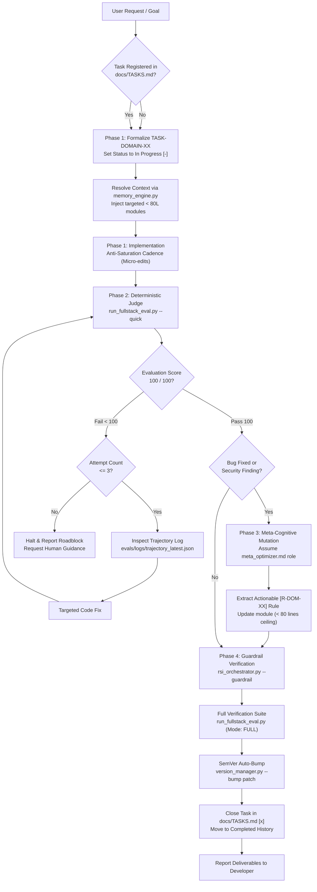

# Agentic RSI Protocol

[](https://opensource.org/licenses/MIT)
[](VERSION)
[](https://www.python.org/)
[]()
[]()
[]()

The **Recursive Self-Improvement (RSI) Protocol** is a language-agnostic engineering framework and deterministic runtime specification designed specifically for modern **Agentic Coding Environments** (such as Cursor, Windsurf, Google Antigravity, Claude Code, GitHub Copilot Workspace, and Cline / Roo Code).

It establishes an inviolable operational contract between human developers and autonomous coding agents: eliminating context saturation, preventing unverified mutations, enforcing deterministic evaluation, and enabling agents to distill debugging lessons into durable procedural memory.

---

## Table of Contents

- [The Challenge with Modern Agentic Coding Environments](#the-challenge-with-modern-agentic-coding-environments)
  - [Real-World Failure Scenario 1: The Monolithic Prompt Attention Dilution](#real-world-failure-scenario-1-the-monolithic-prompt-attention-dilution)
  - [Real-World Failure Scenario 2: Multi-File Cascade Regression & Panic Edits](#real-world-failure-scenario-2-multi-file-cascade-regression--panic-edits)
  - [Real-World Failure Scenario 3: Session Amnesia & The Repeated Trap](#real-world-failure-scenario-3-session-amnesia--the-repeated-trap)
  - [Real-World Failure Scenario 4: Accidental Secret Leakage & Incomplete Gitignore](#real-world-failure-scenario-4-accidental-secret-leakage--incomplete-gitignore)
  - [Real-World Failure Scenario 5: Terminal Charset Crash (Windows CP1252 & CI)](#real-world-failure-scenario-5-terminal-charset-crash-windows-cp1252--ci)
- [The RSI Architectural Solution](#the-rsi-architectural-solution)
- [How It Works: The 4-Phase Execution Cycle](#how-it-works-the-4-phase-execution-cycle)
- [Operational Architecture Diagram](#operational-architecture-diagram)
- [Key Guarantees and Capabilities](#key-guarantees-and-capabilities)
  - [1. Inviolable Single Source of Truth](#1-inviolable-single-source-of-truth-ssot)
  - [2. Memory Duality and Anti-Bloat Guardrails](#2-memory-duality-and-anti-bloat-guardrails)
  - [3. Dynamic Contextual Injection](#3-dynamic-contextual-injection)
  - [4. Adaptive Deterministic Judge](#4-adaptive-deterministic-judge)
  - [5. Meta-Cognitive Mutation Loop](#5-meta-cognitive-mutation-loop)
  - [6. Zero-Leak Security Audit](#6-zero-leak-security-audit)
  - [7. Deterministic Pure ASCII & Emoji Hygiene Enforcement](#7-deterministic-pure-ascii--emoji-hygiene-enforcement)
- [Protocol Versioning Specification](#protocol-versioning-specification)
- [Quick Start Guide](#quick-start-guide)
  - [Using as a GitHub Template](#using-as-a-github-template)
  - [Integrating into an Existing Codebase](#integrating-into-an-existing-codebase)
- [Agent Slash Commands and Workflows](#agent-slash-commands-and-workflows)
  - [`/rsi-feature` - End-to-End Feature Development](#rsi-feature---end-to-end-feature-development)
  - [`/reset-rsi` - Starting a Fresh Project](#reset-rsi---starting-a-fresh-project)
- [Repository Layout](#repository-layout)
- [CLI Tooling Reference](#cli-tooling-reference)
- [Inviolable Rules for AI Agents](#inviolable-rules-for-ai-agents)
- [Contributing](#contributing)
- [License](#license)

---

## The Challenge with Modern Agentic Coding Environments

Autonomous coding agents (Cursor Agent, Windsurf Cascade, Google Antigravity, Claude Code, Cline) can inspect whole workspaces, edit multiple files simultaneously, and execute terminal commands. However, on production codebases, unconstrained agents consistently degrade across five documented failure patterns:

### Real-World Failure Scenario 1: The Monolithic Prompt Attention Dilution
- **The Problem:** Teams frequently create a monolithic 800-line `.cursorrules` or system prompt containing all database, UI, Tailwind, API, and authentication rules.
- **What happens:** After 10 conversation turns, the agent's attention window is flooded with conversational context. The agent suffers from **attention drift** and violates key rules. For example, it might instantiate `const prisma = new PrismaClient()` directly inside an edge serverless function rather than using a singleton client.
- **Production impact:** In serverless architectures (Vercel, AWS Lambda), each invocation spawns a new connection pool, rapidly exhausting PostgreSQL connection limits (`FATAL: remaining connection slots are reserved`) and bringing down production.
- **The RSI Fix:** Rules are decentralized into tiny, single-domain files in `.agents/rules/modules/` (< 80 lines each). `evals/memory_engine.py` dynamically injects only `db.md` when database files are touched, preserving 100% of the agent's attention on critical invariants.

### Real-World Failure Scenario 2: Multi-File Cascade Regression & Panic Edits
- **The Problem:** A developer asks an agent in Composer or Cascade mode to add a new field to a user profile form.
- **What happens:** The agent modifies the TypeScript schema in `types/user.ts` and the frontend form in `ProfileForm.tsx`, but forgets to update the backend action validator in `actions/user.ts`. When running a quick test, it encounters a validation mismatch. In panic mode, the agent begins touching unrelated files, adding `@ts-ignore` comments, altering utility libraries, and introducing breaking changes across 10+ files.
- **The RSI Fix:** The agent must adhere to the 3-tier Anti-Saturation Cadence. Micro-edits proceed freely, but milestone closure triggers `evals/run_fullstack_eval.py --quick`. The deterministic judge catches the exact schema error and logs at most 10 significant lines in `evals/logs/trajectory_latest.json`. The agent is constrained to a 3-attempt repair loop, preventing uncontrolled code mutations.

### Real-World Failure Scenario 3: Session Amnesia & The Repeated Trap
- **The Problem:** An agent spends 40 minutes diagnosing a subtle race condition in an asynchronous job queue. It finally identifies the solution (making the worker strictly idempotent and verifying the webhook signature).
- **What happens:** The developer finishes the session. The next morning, a different developer (or the same developer in a new chat) asks the agent to implement another webhook handler. Having zero cross-session memory, the agent repeats the exact same vulnerability.
- **The RSI Fix:** The Meta-Cognitive Mutation Loop (Phase 3). Whenever a task resolves an incident, the agent adopts `.agents/prompts/meta_optimizer.md` and distills the lesson into a permanent rule (e.g., `[R-API-04] Make asynchronous jobs strictly idempotent...`) committed to git. Future agents inherit the immunization automatically.

### Real-World Failure Scenario 4: Accidental Secret Leakage & Incomplete Gitignore
- **The Problem:** An agent creates a quick script to test a Stripe webhook or Supabase query, hardcoding a real API key or creating an untracked `.env.local` variant.
- **What happens:** The developer runs `git commit -am "add test"` without reviewing every generated artifact. The private key or secret token is pushed to GitHub, triggering security revoke warnings or exposed cloud infrastructure.
- **The RSI Fix:** [`evals/security_audit.py`](evals/security_audit.py) executes before every commit and build. It validates that `.gitignore` actively blocks `.env*`, `*.pem`, `*.key`, and dependencies, while scanning all files with regex patterns for AWS, OpenAI, GitHub, Slack, and database passwords.

### Real-World Failure Scenario 5: Terminal Charset Crash (Windows CP1252 & CI)
- **The Problem:** Developers or agents decorate terminal scripts and test outputs with emojis and Unicode symbols (`[PASS] <checkmark>`, `[FAIL] <cross>`, `Launching... <rocket>`).
- **What happens:** When executed in default Windows PowerShell (CP1252 / ISO-8859-1) or in minimal Linux Docker containers without UTF-8 locale configuration, Python crashes abruptly:
  `UnicodeEncodeError: 'charmap' codec can't encode characters in position 23-24: character maps to <undefined>`
  The agent cannot read its own test results and gets trapped in an unresolvable loop trying to fix functional code that was never broken.
- **The RSI Fix:** The protocol mechanically enforces **pure ASCII output**. The judge in `evals/security_audit.py` actively scans for any non-ASCII or emoji characters across all scripts, rules, and documentation, failing with an exit code 1 if any agent commits an emoji.

---

## The RSI Architectural Solution

The **Agentic RSI Protocol** introduces a deterministic, self-contained closed feedback loop for coding agents:

- **Strict Task Governance:** The agent cannot write or edit code without an explicit task registered in `docs/TASKS.md`.
- **Dynamic Context Injection:** Rather than loading all engineering rules into every prompt, rules are split into modular sub-playbooks (`< 80 lines` each) in `.agents/rules/modules/`. The engine inspects target files and injects only relevant rules.
- **Deterministic Judge:** A lightweight evaluation harness (`evals/run_fullstack_eval.py`) validates typecheck, linters, schemas, security leaks, and memory compactness.
- **Reflexive Auto-Correction:** If the evaluation score is below 100/100, the agent has up to 3 automated retry attempts, reading compact failure logs.
- **Meta-Cognitive Learning:** After resolving an unexpected defect or security finding, the agent distills the fix into an actionable, permanent rule in the appropriate module.

---

## Operational Architecture Diagram



---

## Key Guarantees and Capabilities

### 1. Inviolable Single Source of Truth (SSOT)
- Tracked strictly in `docs/TASKS.md`.
- Tasks must specify an identifier (`TASK-DOMAIN-XX`), priority, target files, and checkable acceptance criteria (`[ ]`).
- Strict ceiling: `docs/TASKS.md` must never exceed **250 lines**. Completed sprints are archived into `docs/archive/tasks/`.

### 2. Memory Duality and Anti-Bloat Guardrails
- **Episodic Memory (IDE Artifacts):** Volatile scratchpads, task checklists, and architectural outlines remain in IDE Brain artifacts rather than chat messages, saving token context.
- **Procedural Memory (Modular Rules):** Permanent engineering rules live in `.agents/rules/modules/`. Each module is strictly limited to **< 80 lines** to prevent LLM attention dilution (*"Lost in the Middle"* effect) and append-only rule rot. When a module nears this ceiling, the agent follows a **2-step lossless consolidation strategy**:
  1. **Synthesize (Merge):** Consolidate only redundant or overlapping directives without sacrificing technical precision (never water down distinct rules into vague generalizations).
  2. **Split (Modularize):** If all rules are distinct and atomic, split the module into finer domain sub-modules (e.g., splitting `api_backend.md` into `api_routes.md` and `async_queues.md`) and register the new triggers in `evals/memory_engine.py` and `.agents/rules/fullstack_playbook.md`.

### 3. Dynamic Contextual Injection
Instead of overwhelming the LLM with generic manuals, `evals/memory_engine.py` maps file paths to domain rules:

```bash
# Example: Injecting rules relevant to an API route and user session
python evals/memory_engine.py --inject src/app/api/auth/route.ts
```

Output:
```
[RSI Dynamic Memory Injection]
--- [Module: api_backend.md] ---
- [R-API-01] Consistently return predictable structures matching { success: true, data } | { success: false, error }.
- [R-API-02] Protect sensitive endpoints and submission forms with rate-limiting.
...
--- [Module: security_auth.md] ---
- [R-SEC-01] Strictly validate sessions and permissions server-side at the start of every controller or action.
...
```

### 4. Adaptive Deterministic Judge
The evaluation engine (`evals/run_fullstack_eval.py`) automatically discovers project tooling without manual configuration:
- Package manager detection (`pnpm`, `bun`, `yarn`, `npm`).
- TypeScript static analysis (`tsc --noEmit`).
- Code style and linting (invokes project `lint` script).
- ORM and database verification (Prisma schema validation, Drizzle checks).
- Security audits (secret leakage and `.gitignore` airtightness).
- Compact failure filtering: captures and outputs at most 10 significant lines per failed step to avoid overflowing prompt context.

### 5. Meta-Cognitive Mutation Loop
When an agent encounters a bug and resolves it, it runs **Phase 3**:
1. Adopts the `.agents/prompts/meta_optimizer.md` persona.
2. Identifies the root architectural failure.
3. Distills a concise, imperative rule (`[R-DOM-XX] Always...`).
4. Updates the matching file in `.agents/rules/modules/` ensuring the file stays under 80 lines (merging redundant rules or splitting into finer domain sub-modules when full).
5. In subsequent sessions, any agent touching related files will receive the distilled rule, preventing regression.

### 6. Zero-Leak Security Audit
[`evals/security_audit.py`](evals/security_audit.py) executes automated static analysis across all files:
- Scans for private cryptographic keys (RSA, EC, OpenSSH).
- Detects provider API tokens (OpenAI, Anthropic, AWS Access Keys, GitHub PATs, Slack).
- Detects unmasked database connection strings (`postgres://...`).
- Verifies `.gitignore` blocks `.env*`, `.pem`, `.key`, and dependencies.

### 7. Deterministic Pure ASCII & Emoji Hygiene Enforcement
Does the protocol really prevent agents from writing emojis? **Yes, mechanically.**
- `evals/security_audit.py` includes a dedicated `audit_ascii_hygiene()` function that executes on every test run.
- It scans all scripts (`evals/*.py`), rule modules (`.agents/**/*.md`), and documentation (`*.md`).
- If an agent inserts an emoji (such as checkmarks, rocket icons, or smileys) or non-ASCII typography (such as em-dashes or smart quotes), the test fails deterministically with exit code 1:
  ```
  [FAIL] 1 non-ASCII / emoji violation(s) detected:
    - [Non-ASCII / Emoji Character] evals/script.py:12 -> print("Done [emoji]")
  [FAIL] SECURITY & HYGIENE AUDIT: FAILED
  ```
- Because the deterministic judge score drops below 100/100, the task CANNOT be closed until the agent replaces the emoji with standard ASCII tags (`[OK]`, `[FAIL]`, `[WARN]`, `[INFO]`).

### 8. Hybrid Pattern Recognition & Fast-Fail Reflexes
To prevent AI agents from wasting tokens on solved problems or introducing operational vulnerabilities, the protocol combines an *a priori* **Cognitive Compass** with an *a posteriori* **Reflex Nervous System**:
- **Cognitive Routing (`.agents/rules/modules/pattern_recognition.md`):** Instructs the agent to route routine boilerplate (`System 1`) to fast execution, reuse existing canonical patterns in $O(1)$ (`[R-PAT-02]`), and reserve deep reasoning (`System 2`) for security boundaries and state concurrency.
- **Fast-Fail Diagnostic Reflex (`--diagnose`):** When an evaluation fails, `python evals/memory_engine.py --diagnose` inspects `evals/logs/trajectory_latest.json` in `< 10ms` and maps known error signatures directly to 1-line deterministic fixes before the agent burns tokens guessing.
- **Operational Anti-Pattern Guard:** `evals/security_audit.py` scans application code to block public frontend secret exposure (`NEXT_PUBLIC_.*SECRET`, `VITE_.*SECRET`), non-singleton ORM instantiations (`new PrismaClient()`), and unsafe dynamic code execution (`eval`, `new Function`).

---

## Protocol Versioning Specification

The Agentic RSI Protocol engine adheres to strict **Semantic Versioning (SemVer 2.0.0)** tracked independently from any application codebase:
- [`VERSION`](VERSION): Single Source of Truth for the protocol specification and workflow version.
- Application manifests (such as `package.json` for Node, `pyproject.toml` for Python, or `Cargo.toml` for Rust) are reserved strictly for the application layer created during project scaffolding (`TASK-INIT-01`).

### Version Management CLI
To bump protocol versions after closing a milestone:
```bash
# Bump patch release (e.g., 0.1.0 -> 0.1.1)
python evals/version_manager.py --bump patch

# Bump minor release (e.g., 0.1.0 -> 0.2.0)
python evals/version_manager.py --bump minor

# Bump with pre-release tag (e.g., 0.2.0 -> 0.3.0-beta)
python evals/version_manager.py --bump minor --mention beta
```
This updates `VERSION`, synchronizes `package.json` if an application is installed, and seals the `[Unreleased]` block in `CHANGELOG.md` with today's date.

---

## Quick Start Guide

### Using as a GitHub Template

1. Click **Use this template** > **Create a new repository** on GitHub.
2. Clone your repository:
   ```bash
   git clone https://github.com/your-username/your-project.git
   cd your-project
   ```
3. Reset template task memory to start fresh:
   ```bash
   python evals/reset_rsi.py --force
   ```
4. Verify baseline health:
   ```bash
   python evals/run_fullstack_eval.py --quick
   ```

### Integrating into an Existing Codebase

Copy the core directories into your project root:
```bash
cp -r .agents/ evals/ docs/ CHANGELOG.md AGENTS.md VERSION /path/to/target-project/
```

Add these standard scripts to your `package.json`:
```json
{
  "scripts": {
    "eval:quick": "python evals/run_fullstack_eval.py --quick",
    "eval:fullstack": "python evals/run_fullstack_eval.py",
    "rsi:inspect": "python evals/stack_inspector.py",
    "rsi:memory": "python evals/memory_engine.py --audit",
    "rsi:security": "python evals/security_audit.py",
    "rsi:reset": "python evals/reset_rsi.py"
  }
}
```

---

## Agent Slash Commands and Workflows

### `/rsi-feature` - End-to-End Feature Development
Triggers the structured 4-phase engineering cycle:
1. **Preparation:** Checks `docs/TASKS.md`, sets status to `[-]`, inspects stack, and injects context rules.
2. **Implementation:** Micro-edits without global check bloat, followed by `python evals/run_fullstack_eval.py --quick`.
3. **Reflexive Loop:** Up to 3 attempts with failure log diagnostics (`evals/logs/trajectory_latest.json`).
4. **Meta-Optimization:** Extracts lessons learned into rule modules if an incident occurred.
5. **Closure:** Verifies guardrails, runs full evaluation (100/100 PASS required), bumps SemVer patch, and seals `docs/TASKS.md`.

### `/reset-rsi` - Starting a Fresh Project
Resets the template state so you can begin work without carrying over past task archives:
- Generates a zip backup in `evals/backups/rsi_backup_<timestamp>.zip`.
- Restores `docs/TASKS.md` to initial task `TASK-INIT-01`.
- Purges `docs/archive/tasks/`.
- Resets `CHANGELOG.md` to version `0.1.0` `[Unreleased]`.
- Purges `evals/logs/`.

---

## Repository Layout

```
Agentic-RSI-Protocol/
|-- .agents/
|   |-- prompts/
|   |   \-- meta_optimizer.md        # Reflexive role for post-mortem rule distillation
|   |-- rules/
|   |   |-- system_core.md           # Invariant engineering rules
|   |   |-- fullstack_playbook.md    # Index & routing layer for procedural memory
|   |   \-- modules/                 # Atomic domain playbooks (< 80 lines each)
|   |       |-- api_backend.md       # API design, async jobs, caching, idempotency
|   |       |-- db.md                # ORM validation, connection pooling, migrations
|   |       |-- integration_ai.md    # LLM inference, structured output, fallbacks
|   |       |-- pattern_recognition.md # Cognitive routing (System 1/2) & O(1) mimicry
|   |       |-- security_auth.md     # Secrets, sessions, permissions, encryption
|   |       \-- ui_frontend.md       # Responsive UI, accessibility, 4 visual states
|   \-- workflows/
|       |-- rsi-feature.md           # 4-phase feature development workflow
|       \-- reset-rsi.md             # Clean-slate project reset workflow
|-- evals/
|   |-- memory_engine.py             # Memory compactness auditor & contextual rule injector
|   |-- reset_rsi.py                 # Pure ASCII task & changelog reset engine
|   |-- rsi_orchestrator.py          # Retry loop controller (max 3) & guardrail checker
|   |-- run_fullstack_eval.py        # Adaptive deterministic judge (multi-package managers)
|   |-- security_audit.py            # Static secret scanner & .gitignore leak validator
|   |-- stack_inspector.py           # Ecosystem detector & official tooling advisor
|   \-- version_manager.py           # SemVer version bump & changelog sealer
|-- docs/
|   |-- ARCHITECTURE.md              # In-depth architectural guide & diagrams
|   |-- TASKS.md                     # Single Source of Truth task registry (< 250L)
|   \-- archive/tasks/               # Rollover folder for completed sprint archives
|-- .gitignore                       # Production-grade secret, log, and cache exclusion
|-- AGENTS.md                        # Formal AI agent contract & behavioral charter
|-- CHANGELOG.md                     # Keep-a-Changelog SemVer tracking
|-- CONTRIBUTING.md                  # Open-source contribution standards (ASCII, tests, PRs)
|-- LICENSE                          # MIT License
|-- VERSION                          # Protocol SemVer version indicator
\-- README.md                        # Documentation & onboarding guide
```

---

## CLI Tooling Reference

All tools are in `evals/` and require Python 3.10+:

| Command | Purpose | Flags / Options |
| :--- | :--- | :--- |
| `python evals/run_fullstack_eval.py` | Runs all deterministic checks (types, lint, security, db) | `--quick` (skips production build) |
| `python evals/security_audit.py` | Scans repository for leaked secrets, operational anti-patterns, and ASCII hygiene | *(None)* |
| `python evals/memory_engine.py` | Audits module limits, injects rules, or diagnoses failed trajectories | `--audit`, `--inject [files...]`, `--diagnose` |
| `python evals/stack_inspector.py` | Detects tech stack and recommends official MCPs and Skills | *(None)* |
| `python evals/reset_rsi.py` | Resets task registry and changelog to a clean template baseline | `--dry-run`, `--force`, `--no-backup` |
| `python evals/rsi_orchestrator.py` | Drives evaluation retry loop and checks guardrails | `--eval`, `--attempt 1..3`, `--guardrail` |
| `python evals/version_manager.py` | Increments SemVer release and seals changelog entry | `--bump [major\|minor\|patch]` |

---

## Inviolable Rules for AI Agents

All AI agents interacting with this repository must strictly adhere to the guidelines codified in [`AGENTS.md`](AGENTS.md):

1. **No Unregistered Coding:** Every modification must correspond to a formalized task in `docs/TASKS.md` with explicit criteria.
2. **Deterministic Validation Before Closure:** No task may be marked completed `[x]` without achieving a 100/100 score on `run_fullstack_eval.py`.
3. **Strict Size Ceilings:** `docs/TASKS.md` must not exceed **250 lines**; sub-modules in `.agents/rules/modules/` must not exceed **80 lines**.
4. **Universal ASCII Output:** All scripts must produce pure ASCII terminal logs to avoid charset encoding failures on Windows or headless CI environments.
5. **Absolute Secret Protection:** Never commit or unmask environment variables, tokens, private keys, or credentials.

---

## Contributing

Please review [CONTRIBUTING.md](CONTRIBUTING.md) for contribution guidelines, conventional commit formats, and the mandatory pure ASCII compliance test.

---

## License

This project is licensed under the [MIT License](LICENSE).
