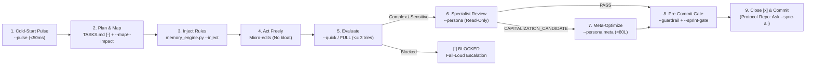

# Agent Operations Guide (`docs/AGENT_OPERATIONS.md`)

> How AI coding agents behave, collaborate, self-check, and learn inside any repository governed by the **Agentic RSI Protocol**.

---

## 1. Core Operating Philosophy: Freedom in the Middle, Strict at the Boundaries

Modern autonomous coding agents perform best when they feel **unencumbered during implementation** and **supported by fast, objective guardrails at milestones**:

1. **Single Strong Lead (Maker):** One primary agent owns end-to-end context, explores the codebase freely, plans, and writes code without bureaucratic handoffs.
2. **Deterministic Harness (`evals/`):** Objective scripts (`run_fullstack_eval.py`, `security_audit.py`, `rsi_orchestrator.py`, `stack_inspector.py`) replace guesswork with fast, compact JSON/ASCII signals.
3. **Progressive Disclosure (`< 80L` / `< 40L`):** Agents never ingest monolithic 800-line instruction manuals. `memory_engine.py --inject` loads only domain rules matching target files, and `--persona` extracts only the single specialist persona needed.
4. **On-Demand Maker / Checker Separation (`rsi-specialist`):** For low-risk `XS`/`S` tasks, the Lead works solo. For complex (`M`/`L`/`XL`) or high-risk changes, the Lead summons an isolated read-only Checker persona (`architect`, `db`, `security`, `ui`, `qa`) from `.agents/prompts/rsi_specialist.md` to eliminate self-validation bias.

---

## 2. How an Agent Executes a Task (End-to-End Lifecycle)



### Step-by-Step Behavior
1. **Cold-Start Orientation:** Every session begins with `python evals/rsi_orchestrator.py --pulse` to read repository health, active `[-]` or `[!] BLOCKED` tasks, `[Scope: XS..XL]`, Blast Radius, git status, and missing official Skills/MCP tools.
2. **SSOT Discipline (`docs/TASKS.md`):** No code is edited without a formalized task (`TASK-DOMAIN-XX`), declared `Target files`, and checkable acceptance criteria. Status updates happen in real time: `[ ]` -> `[-]` -> `[x]` (or `[!]` on impasse).
3. **Topological Discovery:** Before creating helpers or changing shared interfaces, the agent runs `stack_inspector.py --map` (reuse existing singletons in $O(1)$) and `--impact <file>` (measure reverse dependencies).
4. **Anti-Saturation Cadence:**
   - *Micro-edits:* Free editing flow without running global suites on every line.
   - *Milestone:* Compact `python evals/run_fullstack_eval.py --quick` (error logs capped to 10 significant lines).
   - *Task Closure:* Full deterministic judge (`python evals/run_fullstack_eval.py`, `100/100 PASS` required) + `python evals/rsi_orchestrator.py --guardrail`.
   - *Pre-Commit / Sprint Closure:* Net-new `python evals/rsi_orchestrator.py --sprint-gate` (prod dependency CVEs, `public/` assets `> 500 KB`, static N+1 DB loop patterns, touched UI page LCP reminder) without duplicating already-passed task checks.

---

## 3. Maker / Checker Separation & `rsi-specialist` Personas

All specialist personas live in a single tagged catalog: [`.agents/prompts/rsi_specialist.md`](../.agents/prompts/rsi_specialist.md). Each persona block is audited by `evals/memory_engine.py --audit` to stay strictly under **40 non-empty lines**.

To extract **only** the common Checker core + one persona (zero context pollution):
```bash
python evals/memory_engine.py --list-personas
python evals/memory_engine.py --persona security
```

| Persona | Mode | Trigger Condition | Primary Responsibility |
| :--- | :--- | :--- | :--- |
| `architect` | `READ-ONLY` | `[Scope: L / XL]` or `HIGH` hub edits | Blast Radius, singleton reuse, interface contracts, splitting oversized tasks into `S`/`M`. |
| `db` | `READ-ONLY` | `prisma/`, `drizzle`, SQL, RLS | Non-destructive migrations, indexes, Supabase RLS, Better-Auth sync, N+1 prevention. |
| `security` | `READ-ONLY` | API routes, Server Actions, auth, uploads, webhooks | Server-side auth, IDOR ownership, Zod validation, rate-limiting, MIME/size/signed URLs, pre-commit diff review. |
| `ui` | `READ-ONLY / BROWSER` | `page.tsx`, `layout.tsx`, `components/`, CSS | Canonical `Header`/`Footer` layout, design-system tokens (anti-AI slop), 4 visual states, 0 orphan components, LCP check. |
| `qa` | `READ-ONLY / TESTS` | `M+` features, critical bugs | Edge cases, concurrency, idempotent retries, verifying assertions test real behavior (zero reward hacking). |
| `meta` | `WRITE-RULES-ONLY` | Phase 3 (post-incident or accepted `CAPITALIZATION_CANDIDATE`) | Distills lessons into `.agents/rules/modules/*.md` (`< 80L` ceiling, zero redundancy, lossless merge or split). |

### Closing the Learning Loop (`CAPITALIZATION_CANDIDATE`)
Read-only reviewer personas (`architect`, `db`, `security`, `ui`, `qa`) **never write directly** to `.agents/rules/modules/`. Instead, whenever they catch a structural or recurring defect that bypassed `tsc`/`lint` (such as an unstyled off-brand component or an unprotected public endpoint), they emit an optional 1-line `CAPITALIZATION_CANDIDATE` in their verdict (`PASS` | `CHANGES_REQUIRED` | `BLOCKED`). In Phase 3, the `meta` persona deduplicates and persists valuable candidates into the appropriate `< 80L` rule module.

---

## 4. Behavioral Contract & Cognitive Comfort

1. **Fail-Loud Honesty & Zero Reward Hacking:**
   - Agents must **never** hide errors, fake passing output, or weaken tests, linters, type checks, or `evals/` validators just to reach `100/100`.
   - Reporting a real blocker accurately is treated as protocol success, never penalized.
2. **Blameless Escalation (`[!] BLOCKED`):**
   - *Technical bugs:* Bounded 3-attempt repair loop with `memory_engine.py --diagnose`.
   - *External / structural blockers* (missing credentials, conflicting rules, suspected validator false positive): Halt immediately on attempt 1, mark the task `[!]` (`BLOCKED`) in `docs/TASKS.md`, and present exact logs, attempted fixes, and clear options to the developer.
3. **Anti-AI-Slop & Secure-by-Default Standards:**
   - Public pages inherit canonical `Header`/`Footer` chrome and use semantic design-system tokens/primitives.
   - Obsolete replaced components with `0` incoming imports are removed immediately.
   - Public endpoints and uploads enforce schema validation, rate-limiting, MIME/size limits, and auth/ownership checks from the first draft.

---

## 5. Memory Duality & Multi-Project Synchronization

- **Episodic Memory:** IDE Artifacts (`plan.md`, checklists) and ephemeral `.agents/telemetry/active_session.json` keep volatile session scratchpads out of permanent files.
- **Procedural Memory:** Durable atomic rules live in `.agents/rules/modules/*.md` (`< 80L` each), complemented by invariant contracts in `.agents/rules/system_core.md` and `AGENTS.md`.
- **Non-Destructive Multi-Project Sync (`--sync-to` / `--sync-all`):**
  - Target project paths are stored locally in git-ignored `.agents/telemetry/sync_targets.json`.
  - On the source protocol repo, agents always ask the human before syncing after a commit.
  - `AGENTS.md` uses `<!-- RSI-PROTOCOL:START / END -->` markers so project-specific rules under `## Project-Specific Rules` are preserved automatically; any pre-existing unmarked `AGENTS.md` is backed up to `evals/backups/AGENTS.md.<timestamp>.bak` for human-guided review.
  - Synced protocol files are automatically exempt from `Scope Guard` drift warnings in consumer repositories while remaining strictly guarded on the source protocol repository.
